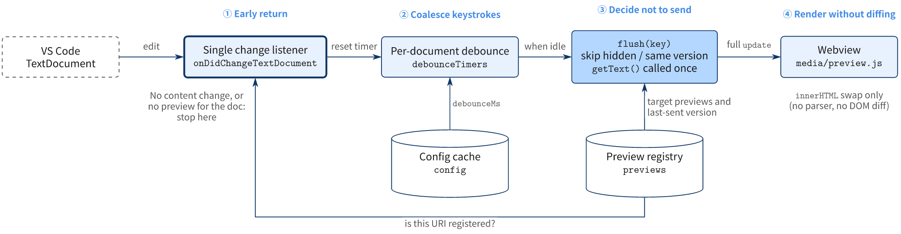
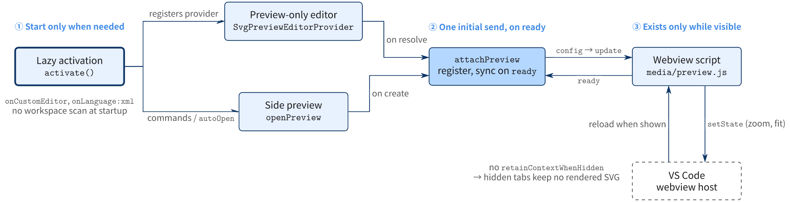

# Lightweight SVG Previewer

[](https://marketplace.visualstudio.com/items?itemName=ryonak.lightweight-svg-previewer)
[](LICENSE)
[](#development)

A no-frills VS Code extension for SVG files. Opening an `*.svg` shows the
**rendered preview only**; press <kbd>Ctrl</kbd>+<kbd>Enter</kbd> to open the
source beside it and watch edits render live. Zero runtime dependencies,
strict CSP, fast on 1 MB+ SVGs.

> Open an SVG, see it. Need the code? <kbd>Ctrl</kbd>+<kbd>Enter</kbd>.

---

## ✨ Features

- 👀 **Preview-first.** `*.svg` opens directly in the **SVG Preview**
  editor — no source shown. Press <kbd>Ctrl</kbd>+<kbd>Enter</kbd>
  (<kbd>Cmd</kbd>+<kbd>Enter</kbd> on macOS) with the preview focused to open
  the source to the side; edits are reflected live.
- ⚡ **Live updates.** Edits are reflected in real time with a configurable
  debounce (default 150 ms).
- ↔️ **Side preview for text editors.** When an SVG is open as text, toggle
  a preview beside it with <kbd>Ctrl</kbd>+<kbd>K</kbd> <kbd>V</kbd> (or set
  `autoOpen: true`).
- 🪶 **Lightweight.** No bundlers, no SVG parsers, no DOM diffing. The
  webview swaps `innerHTML`. Comfortable on 1 MB+ SVGs because the debounce
  coalesces edits and rendering uses the browser's native engine.
- 💤 **Idle when hidden.** Hidden previews are released by VS Code and get
  no updates; they resync on show, keeping zoom via webview state.
- 🔍 **Zoom & fit.** Toolbar buttons (`−` / `100%` / `+` / `fit`) and
  `Ctrl/Cmd + scroll` to zoom.
- 🛡️ **Strict CSP.** Per-panel `script-src 'nonce-…'`; no inline scripts,
  no remote resources, scripts inside SVG are stripped on render.
- 🧰 **Zero runtime deps.** Only `typescript` / `@types/*` / `@vscode/vsce`
  are dev-time tooling.

## 🚀 Quick Start

### Install from VSIX (local)

```bash
npm install
npm run compile
npm run package          # → lightweight-svg-previewer-0.1.0.vsix
code --install-extension lightweight-svg-previewer-0.1.0.vsix
```

Reload VS Code and open any `.svg` — it opens in the SVG Preview editor.
Press <kbd>Ctrl</kbd>+<kbd>Enter</kbd> (<kbd>Cmd</kbd>+<kbd>Enter</kbd> on
macOS) in the preview to open the source to the side.

> Upgrading from 0.0.x? If your user `settings.json` has
> `"workbench.editorAssociations": { "*.svg": "default" }`, remove that entry,
> otherwise SVGs keep opening as text.

### Install from Marketplace

> Available once published. The Marketplace listing will use the publisher
> id `ryonak`.

```bash
code --install-extension ryonak.lightweight-svg-previewer
```

## ⚙️ Configuration

| Key                                    | Type      | Default        | Description                                                          |
| -------------------------------------- | --------- | -------------- | -------------------------------------------------------------------- |
| `lightweightSvgPreviewer.debounceMs`   | `number`  | `150`          | Delay between the last edit and a preview refresh. Range: `0`–`2000`. |
| `lightweightSvgPreviewer.autoOpen`     | `boolean` | `false`        | Auto-open the preview when an SVG file is opened. Off by default — open via the keybinding or command. |
| `lightweightSvgPreviewer.background`   | `string`  | `checkerboard` | One of `checkerboard` / `editor` / `transparent` / `white` / `black`. |

Settings update live — no reload required.

## 🔧 Commands & Keybindings

| Command                                          | Title                                | Default keybinding                                  | When                                                      |
| ------------------------------------------------ | ------------------------------------ | --------------------------------------------------- | --------------------------------------------------------- |
| `lightweightSvgPreviewer.showPreview`            | SVG Preview: Open SVG Preview to the Side | —                                                   | Always (palette / editor title bar / Explorer context).   |
| `lightweightSvgPreviewer.togglePreview`          | SVG Preview: Toggle Preview          | <kbd>Ctrl</kbd>+<kbd>K</kbd> <kbd>V</kbd> (chord)   | `editorTextFocus && resourceExtname == .svg`              |
| `lightweightSvgPreviewer.showSource`             | SVG Preview: Show Source to the Side | <kbd>Ctrl</kbd>+<kbd>Enter</kbd> (<kbd>Cmd</kbd>+<kbd>Enter</kbd> on macOS) | SVG Preview editor is active                              |

> The keybinding follows VS Code's <kbd>Ctrl</kbd>+<kbd>K</kbd> chord
> family (same prefix as <kbd>Ctrl</kbd>+<kbd>K</kbd> <kbd>V</kbd> for the
> built-in Markdown preview). Rebind via **Preferences: Open Keyboard
> Shortcuts** if you have a conflict.

## 🧠 How it works

### Update pipeline — how one edit reaches the preview



1. **Early return.** One `onDidChangeTextDocument` listener serves every
   preview. Events with no content change, and documents that have no
   preview, stop after a single map lookup.
2. **Coalesce keystrokes.** One debounce timer per document (default
   150 ms, read from a cached config). While you type, the only work is
   resetting that timer.
3. **Decide not to send.** When the timer fires, previews that are hidden
   or already have the current `document.version` are skipped.
   `getText()` runs once and the string is shared by all remaining previews.
4. **Render without diffing.** The webview strips `<script>` and swaps
   `innerHTML`. There is no SVG parser and no DOM diff.

### Webview lifecycle — how startup and memory stay low



1. **Start only when needed.** The extension activates on
   `onCustomEditor` (opening an SVG) or `onLanguage:xml` (for `autoOpen`).
   It does not scan the workspace at startup.
2. **One initial send, on `ready`.** The preview-only editor and the side
   preview share `attachPreview`. It sends the config and the full text
   once the webview script reports `ready`, and never before.
3. **Exists only while visible.** Previews don't use
   `retainContextWhenHidden`, so VS Code discards hidden webviews and they
   hold no rendered SVG. When shown again, the webview reloads, sends
   `ready`, and resyncs. Zoom and fit are kept with `setState`.

Each panel's HTML gets a fresh CSP nonce (no inline scripts).

## 🏎️ Performance

- The default 150 ms debounce keeps end-to-end refresh under ~200 ms on
  a typical machine.
- For very large SVGs (≥ 1 MB) raise the debounce to keep typing snappy:
  ```jsonc
  "lightweightSvgPreviewer.debounceMs": 300
  ```
- Switching back to a hidden tab re-renders the SVG once, because hidden
  webviews are discarded to save memory. On very large SVGs this can
  cause a brief delay.

## ❓ FAQ / Troubleshooting

**How do I see the source?**
Focus the SVG Preview editor and press <kbd>Ctrl</kbd>+<kbd>Enter</kbd>, or
click the "Show Source to the Side" button in the editor title bar. To open
an SVG as text instead, use **Reopen Editor With… → Text Editor**.

**How do I open a side preview from a text editor?**
Use the keybinding
<kbd>Ctrl</kbd>+<kbd>K</kbd> <kbd>V</kbd> while focused on an `.svg`, run
**SVG Preview: Open SVG Preview to the Side** from the command palette, or
right-click an `.svg` in the Explorer. To opt in to auto-open, set
`lightweightSvgPreviewer.autoOpen` to `true`.

**My `.svg` opens as text or as an image, not in SVG Preview.**
You have a user-level `*.svg` entry in `workbench.editorAssociations`. Remove
it from `settings.json` (or set it to `lightweightSvgPreviewer.editor`).

**Updates feel slow.**
Lower `lightweightSvgPreviewer.debounceMs` toward `50`. Pushing it below
`30` is rarely useful: most of the perceived delay is the browser's reflow
on `innerHTML` for large SVGs, not the debounce itself.

**My SVG contains `<script>`. Will it execute?**
No. The webview enforces a strict CSP (`script-src 'nonce-…'`) and the
extension also strips `<script>…</script>` blocks before rendering.

**Will this work over SSH / WSL / Codespaces?**
Yes. The extension does no native I/O — only string passing through
`postMessage`.

## 🚧 Limitations / Non-goals

- No SVG editing GUI.
- No DOM inspector / element picker.
- No animation timeline; SMIL and CSS animations render as the browser does.
- No export. Use VS Code's built-in image preview if you need PNG export.

## 🛠️ Development

```bash
git clone https://github.com/RyoNak/lightweight-svg-previewer
cd lightweight-svg-previewer
npm install

npm run typecheck   # tsc --noEmit
npm test            # node --test (zero new deps)
npm run compile     # → dist/extension.js
npm run package     # → *.vsix via @vscode/vsce
```

Run the extension in a development host: open the folder in VS Code and
press <kbd>F5</kbd>.

### Project layout

```
src/
  extension.ts     — activation, panel manager, debounce, message wiring
  util.ts          — pure helpers (testable in node:test)
  util.test.ts     — unit tests
docs/figures/     — architecture diagrams (.tikz sources, rendered by tikzc;
                     *-en.png are used in this README, Japanese docs in index.md)
media/
  preview.js       — webview script: message → innerHTML
  preview.css      — fit-to-window, theme variables
images/
  icon.svg         — source for marketplace icon
  icon.png         — 128×128 marketplace icon
```

### Tests

`npm test` compiles TypeScript and runs Node's built-in test runner against
`dist/**/*.test.js`. The test suite covers the pure helpers in `src/util.ts`:

- file-name / language-id detection
- nonce generation (length, charset, uniqueness)
- CSP construction
- config coercion (debounce clamping, background enum, fallbacks)
- defensive `<script>` stripping

The webview-side script and the `vscode`-API-coupled glue in
`extension.ts` are not unit-tested — exercise those by pressing <kbd>F5</kbd>
in the development host.

## 📜 Changelog

See [CHANGELOG.md](CHANGELOG.md).

## 🤝 Contributing

Issues and PRs welcome at
[github.com/RyoNak/lightweight-svg-previewer](https://github.com/RyoNak/lightweight-svg-previewer).
Please run `npm test` and `npm run typecheck` before submitting.

## 📄 License

[MIT](LICENSE) © RyoNak
