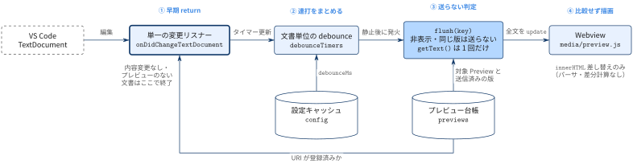

[← 目次](../index.md)

# プレビュー更新パイプライン

**問い：** 1 回の編集がプレビューに届くまでに，どこで仕事を省いて軽く・速くしているか．

編集可能なソース：[diagram.tikz](diagram.tikz)（英語版：[diagram-en.tikz](diagram-en.tikz)，[diagram-en.png](diagram-en.png)）

## 流れ

1. **① 早期 return** — [単一の変更リスナー](change-listener/description.md)が，内容変更の無いイベントとプレビューの無い文書を即座に捨てる．
2. **② 連打をまとめる** — [文書単位の debounce](debounce-timers/description.md)が，静止するまで送信を遅らせる．間隔は[設定キャッシュ](config-cache/description.md)から読む．
3. **③ 送らない判定** — [flush](flush/description.md)が[プレビュー台帳](preview-registry/description.md)を見て，非表示・送信済みの版を除外し，`getText()` を 1 回だけ呼ぶ．
4. **④ 比較せず描画** — [Webview 描画](webview-renderer/description.md)は `innerHTML` を差し替えるだけ．

起点は外部の [VS Code TextDocument](vscode-text-document/description.md)．

## 根拠

- [`src/extension.ts`](../../../src/extension.ts) — `activate`（`onDidChangeTextDocument`），`flush`，`send`，`previews`，`debounceTimers`
- [`media/preview.js`](../../../media/preview.js) — `setContent`

## 省略した関係

- `onDidChangeConfiguration` から全プレビューへの `config` 送信（`background` 変更時のみ）は図から省き，[設定キャッシュ](config-cache/description.md)に記載した．
