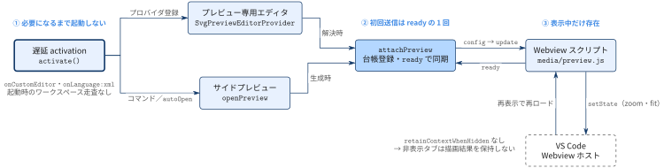

[← 目次](../index.md)

# Webview ライフサイクル

**問い：** 拡張機能の起動からプレビューの生成・非表示・再表示までで，どうやって起動コストとメモリを抑えているか．

編集可能なソース：[diagram.tikz](diagram.tikz)（英語版：[diagram-en.tikz](diagram-en.tikz)，[diagram-en.png](diagram-en.png)）

## 流れ

1. **① 必要になるまで起動しない** — [遅延 activation](activation/description.md)は SVG を開いたときなどにだけ走り，[プレビュー専用エディタ](custom-editor-provider/description.md)と[サイドプレビュー](side-panel/description.md)を登録する．
2. **② 初回送信は ready の 1 回** — どちらも [attachPreview](attach-preview/description.md) を通り，[Webview スクリプト](webview-script/description.md)の `ready` を待ってから送る．
3. **③ 表示中だけ存在** — [VS Code Webview ホスト](vscode-webview-host/description.md)が非表示の webview を破棄し，再表示で再ロードする．ズームは `setState` で残る．

## 根拠

- [`package.json`](../../../package.json) — `activationEvents`
- [`src/extension.ts`](../../../src/extension.ts) — `activate`，`attachPreview`，`openPreview`，`SvgPreviewEditorProvider`
- [`media/preview.js`](../../../media/preview.js) — `getState` / `setState`，`ready`

## 省略した関係

- `showSource`（Ctrl+Enter）によるテキストエディタ表示は軽量化と無関係なので省いた．
- `onDidCloseTextDocument` によるサイドパネルの破棄は省いた．
